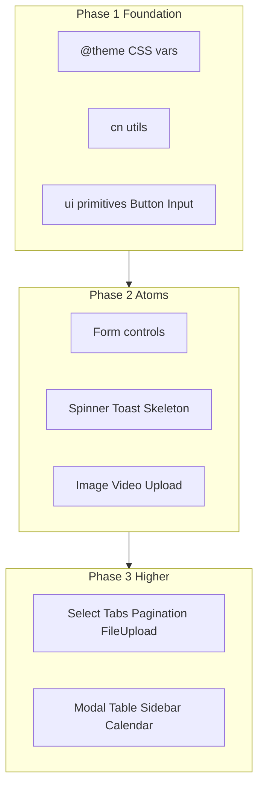

# Components → TypeScript + Tailwind (SOTA Boilerplate)

## Decision (locked in)

Treat this as a **design-system rewrite**, not a mechanical JS→TS /
CSS-module→Tailwind port.

- **UI stack:** Tailwind v4 + [shadcn/ui](https://ui.shadcn.com) patterns (Radix
  primitives + `class-variance-authority` + `clsx`/`tailwind-merge`)
- **Forms:** standardize on **react-hook-form + zod** (already in deps); retire
  Formik from new components (`ScrollToError` becomes RHF-friendly)
- **Scope:** rebuild a curated kit under `src/components`, then delete dead CSS
  modules / unused stubs
- **App usage today:** only
  [`FileUpload`](src/components/molecules/FileUpload/FileUpload.jsx) is imported
  from `src/app` — safe to reshape boldly

---

## Phase 0 — Design-system foundation

1. Init shadcn for Tailwind v4 (`components.json`, `src/components/ui/`,
   `src/lib/utils.ts` with `cn()`).
2. Map existing tokens from
   [`src/app/styles/color.css`](src/app/styles/color.css) into Tailwind `@theme`
   in [`src/app/styles/globals.css`](src/app/styles/globals.css)
   (`--color-primary`, `--color-border`, `--color-error`, etc.) so utilities
   like `bg-primary` / `text-error` work.
3. Convention for all components:
   - `ComponentName/index.tsx` (or shadcn `ui/button.tsx`)
   - typed props, `"use client"` only when needed
   - Tailwind only — **no new CSS modules**
   - barrel exports from layer indexes where useful

---

## Phase 1 — Core UI primitives (replace atoms)

| Keep / rebuild  | Better solution                                                                                 |
| --------------- | ----------------------------------------------------------------------------------------------- |
| Button          | shadcn `Button` + CVA variants (`primary`, `outlined`, `text`, loading)                         |
| Input, TextArea | shadcn `Input` / `Textarea` + shared `Field` (label, error, `aria-*`)                           |
| Spinner         | keep custom [`Spinner`](src/components/atoms/Spinner/Spinner.tsx); delete CSS module → Tailwind |
| LoadingSkeleton | shadcn `Skeleton`                                                                               |
| RenderToast     | keep thin wrapper over `react-toastify` (or migrate to `sonner` later)                          |
| NoDataFound     | simple TSX + Tailwind empty state                                                               |
| DynamicImage    | typed `next/image` wrapper                                                                      |

**Consolidate loaders (6 → 3):**

- Keep: `Spinner`, `Skeleton`, `LinkLoader` (Next `useLinkStatus` portal)
- Delete / fold: `Loader`, `LottieLoader` (misnamed, no Lottie),
  `SpinnerLoading` → use `Spinner` + layout classes

**Consolidate uploads (4 → 2):**

- `FileUpload` (dropzone, multi) as molecule
- Single `MediaUpload` atom for single image/video (merge `ImageUpload` +
  `UploadImageBox` + `UploadVideoBox`)

---

## Phase 2 — Form controls with modern libs

| Current                                      | Replacement                                                                        |
| -------------------------------------------- | ---------------------------------------------------------------------------------- |
| `react-phone-input-2`                        | Custom country select + input using `libphonenumber-js` (already owned) + Tailwind |
| `react-multi-date-picker` (+ purple theme)   | shadcn Calendar / Popover + `date-fns` (already in deps)                           |
| `react-quill-new` (not even in package.json) | TipTap (`@tiptap/react`) rich text — or drop CMS Quill path until needed           |
| `ScrollToError` (Formik)                     | RHF helper: scroll/focus first invalid field                                       |
| `@szhsin/react-menu` MenuPopup               | shadcn `DropdownMenu` (Radix)                                                      |

Shared form API: `label`, `error`, `disabled`, `className`, `name` compatible
with RHF `Controller` / `register`.

---

## Phase 3 — Molecules

| Component             | Action                                                                                                         |
| --------------------- | -------------------------------------------------------------------------------------------------------------- |
| DropDown              | shadcn `Select` or keep `react-select` behind typed Tailwind-styled wrapper                                    |
| Tabs                  | shadcn `Tabs`                                                                                                  |
| Pagination            | typed Tailwind pagination                                                                                      |
| FileUpload            | TSX + Tailwind; keep `react-dropzone`                                                                          |
| PlacesInput / MapView | keep Google Maps stack; convert to TSX + Tailwind; prefer `@vis.gl/react-google-maps` only if rewrite is cheap |
| Header                | rebuild as real marketing/app header with Tailwind (or delete if unused marketing stub)                        |

---

## Phase 4 — Organisms / templates

| Component                 | Action                                                                                                                          |
| ------------------------- | ------------------------------------------------------------------------------------------------------------------------------- |
| Modal / AreYouSure        | shadcn `Dialog` + confirm dialog                                                                                                |
| AppTable + tableHelper    | typed table; replace `moment` with `date-fns`; switch cell → accessible Tailwind switch                                         |
| Sidebar / SidebarSkeleton | rename skeleton → `AppShell` / `DashboardLayout`; TSX + Tailwind                                                                |
| Calender                  | rename → `Calendar`; keep `react-big-calendar` with `date-fns` localizer; move global `style.css` into scoped Tailwind/`@layer` |
| MapAndPlaces              | thin typed composition                                                                                                          |
| CMSDetail                 | TSX; TipTap instead of Quill; wire RHF+zod                                                                                      |
| Home template             | delete placeholder or replace with real starter page                                                                            |

---

## Phase 5 — Cleanup for boilerplate quality

- Delete all `*.module.css` under `src/components` once migrated
- Remove unused deps: `react-phone-input-2`, `react-multi-date-picker`,
  `prop-types`, `@szhsin/react-menu` (if fully replaced), Formik if no remaining
  consumers
- Fix `moment` usage (not in package.json) → `date-fns`
- Ensure `tsconfig` + path aliases remain clean; update app imports to
  `@/components/...`
- Add a short `src/components/README.md` listing the kit and import patterns

---

## Execution order (concrete)

1. Foundation: `cn`, `@theme` tokens, shadcn
   `button`/`input`/`label`/`textarea`/`skeleton`/`dialog`/`dropdown-menu`/`tabs`/`select`/`calendar`/`popover`/`switch`
2. Migrate atoms used by higher layers first: Button, Input, TextArea, Spinner,
   Skeleton, Field, Toast, MediaUpload
3. Molecules: FileUpload (only live consumer), then Select/Tabs/Pagination
4. Organisms: Modal, Table, Sidebar shell, Calendar
5. Deprecate old folders, remove CSS modules and dead packages

---

## Success criteria

- No CSS modules under `src/components`
- All components are `.tsx` with typed props
- One spinner primitive, one media-upload primitive, one confirm dialog pattern
- Tailwind utilities + design tokens drive styling
- `npm run build` / `tsc --noEmit` clean for component layer
- New feature work can start from `ui/*` + documented atoms/molecules without
  inventing another CSS-module stack
